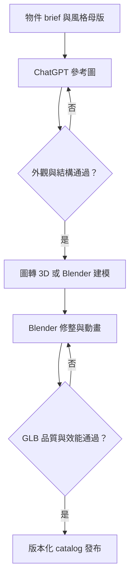

## 5. ChatGPT Image → 3D 的素材製作策略

ChatGPT 生成外觀參考圖，圖轉 3D 工具產生初始 mesh，再由 Blender 修整、烘焙、綁骨與匯出。OpenAI 官方圖片介面描述的是 PNG/JPEG/WebP 圖片輸出；本計畫不能假設圖片生成會同時交付 GLB、拓樸與骨架。[OpenAI 圖片生成](https://developers.openai.com/api/docs/guides/image-generation)

Meshy 提供 Image to 3D 介面，可作試製候選；其程式化 Rigging 文件對標準雙足人形的限制較明確。因此第一版把 20 個人物設為骨架動畫對象，四足動物先用整體路徑移動，避免把所有動物自動綁骨當成已驗證能力。網頁版與 API 能力應分開核對。[Image to 3D](https://docs.meshy.ai/en/api/image-to-3d)、[Rigging API](https://docs.meshy.ai/en/api/rigging)、[網頁動畫功能](https://docs.meshy.ai/en/webapp/guides/animate)

### 5.1 批次工作流



1. 先定一張已核准的風格母版與 10 個 pilot briefs。
2. 每物件先出 1–3 張候選，選定唯一 canonical reference；不把所有候選都轉模。
3. 主參考圖以單一物件、完整 3/4 視角、簡單背景呈現；人物四肢可辨，適合綁骨。
4. 需要背面或側面時以核准圖作編輯參考，分開輸出檔案；人工比對外形一致性。多視圖不保證幾何一致，不把四格角色圖直接當單張模型照片輸入。
5. 以 Meshy 候選或 Blender 建立粗模。保留 raw output，不能直接進正式素材櫃。
6. Blender 修整背面、手腳、孔洞、法線、UV、材質、接地原點與比例；降低面數，製作 LOD。
7. 人物修拓樸、骨架與權重，測 idle/walk/wave；動作物拆可動節點。逐段檢查穿插及變形。
8. GLB 驗證，產生壓縮版、真實 GLB 縮圖、測試報告、provenance。
9. 產品看 360 度轉台、美術看結構、工程看性能；全部 PASS 才將 assetVersion 加入 release catalog。

首發是人工管理的素材管線；不以模擬點擊大量自動操作 ChatGPT 作正式生產依賴。若日後改用 OpenAI API 或圖轉 3D API，另立工作與費用配置；不能把 ChatGPT 帳號方案的使用權當成已含 API 用量。

### 5.2 統一圖像 brief

風格：精緻微縮沙盤公仔、半寫實、暖色中性、霧面樹脂或木質手感、適度圓潤、輪廓清楚。精緻表現在形狀與材質，不以高面數、複雜光效或大量裝飾達成。人物表情中性、衣著完整、無品牌與特定影視角色。不得使用真實案主影像或身份故事作生成輸入。

通用生成 prompt 範本：

> 製作一個供線上沙盤 3D 建模參考的單一【物件名稱】。遵循附上的核准風格參考：精緻微縮公仔、柔和霧面材質、清楚輪廓、溫暖中性色。物件完整入鏡，置中，留足邊界，3/4 視角，接近正交投影，柔和均勻光線。單純淺灰背景，無地景、無底座、無文字、無標誌、無浮水印、無景深模糊、無多餘配件。所有部件結構清楚，避免細長易斷結構。只生成一個完整物件。特徵：【本項固定特徵】；主色：【配色】；可動部位：【動作 brief，若無則填無】。

人物加註：站立中性 A-pose、雙腳微分、雙臂略離軀幹、雙手可辨、衣服不遮住關節、全身比例一致。坐姿與蹲姿由動畫／姿勢處理，不以綁骨困難的坐姿主圖作所有人物起點。

多視圖補圖 prompt：沿用此核准角色的相同衣著、色彩、比例、髮型和配件，只改成【正面／背面／側面】的近正交完整視圖；不要添加新部件。補圖不一致時以 canonical reference 與人工設計決策為準。

圖像來源紀錄：assetId、briefVersion、prompt、參考圖片 hash、生成日期、使用介面、可確認的模型名稱（未知填 unknown）、候選編號、核准者、圖轉 3D 工具版本、加工紀錄、適用條款審閱狀態。相同 prompt 不保證重現同一圖片，因此必須保存已核准的實際圖片檔。

## 6. 100 個模型清單與動畫範圍

所有項目初始狀態為 PLANNED；以下是待製作清單，不表示已生成。名稱只描述外觀，不預設象徵或診斷含意。

動畫代碼：H＝人形骨架 idle/walk/wave；M＝指定節點／形變動作；S＝靜態模型。H、M、S 全部可以手動變形與沿路徑位移。每房同時播放動畫預設最多 5 件。

| ID | 分類 | 模型 | 動畫 | 動作要求 | 批次 |
|---|---|---|---|---|---|
| ST-001 | 人物 | 幼童短髮 | H | idle／walk／wave | BATCH |
| ST-002 | 人物 | 幼童長髮 | H | idle／walk／wave | BATCH |
| ST-003 | 人物 | 學齡兒童短髮 | H | idle／walk／wave | BATCH |
| ST-004 | 人物 | 學齡兒童長髮 | H | idle／walk／wave | BATCH |
| ST-005 | 人物 | 青少年短髮 | H | idle／walk／wave | BATCH |
| ST-006 | 人物 | 青少年長髮 | H | idle／walk／wave | BATCH |
| ST-007 | 人物 | 年輕成人短髮 | H | idle／walk／wave | PILOT-10 |
| ST-008 | 人物 | 年輕成人長髮 | H | idle／walk／wave | BATCH |
| ST-009 | 人物 | 中年成人短髮 | H | idle／walk／wave | BATCH |
| ST-010 | 人物 | 中年成人長髮 | H | idle／walk／wave | BATCH |
| ST-011 | 人物 | 年長成人短髮 | H | idle／walk／wave | BATCH |
| ST-012 | 人物 | 年長成人長髮 | H | idle／walk／wave | BATCH |
| ST-013 | 人物 | 穿白袍人物 | H | idle／walk／wave | BATCH |
| ST-014 | 人物 | 穿圍裙人物 | H | idle／walk／wave | BATCH |
| ST-015 | 人物 | 穿工作服人物 | H | idle／walk／wave | BATCH |
| ST-016 | 人物 | 穿運動服人物 | H | idle／walk／wave | BATCH |
| ST-017 | 人物 | 背書包人物 | H | idle／walk／wave | BATCH |
| ST-018 | 人物 | 穿雨衣人物 | H | idle／walk／wave | BATCH |
| ST-019 | 人物 | 穿斗篷人物 | H | idle／walk／wave | BATCH |
| ST-020 | 人物 | 中性簡約人偶 | H | idle／walk／wave | PILOT-10 |
| ST-021 | 動物 | 貓 | S | 無預製動畫；可路徑位移 | PILOT-10 |
| ST-022 | 動物 | 狗 | S | 無預製動畫；可路徑位移 | BATCH |
| ST-023 | 動物 | 熊 | S | 無預製動畫；可路徑位移 | BATCH |
| ST-024 | 動物 | 兔 | S | 無預製動畫；可路徑位移 | BATCH |
| ST-025 | 動物 | 狐狸 | S | 無預製動畫；可路徑位移 | BATCH |
| ST-026 | 動物 | 狼 | S | 無預製動畫；可路徑位移 | BATCH |
| ST-027 | 動物 | 獅子 | S | 無預製動畫；可路徑位移 | BATCH |
| ST-028 | 動物 | 老虎 | S | 無預製動畫；可路徑位移 | BATCH |
| ST-029 | 動物 | 大象 | S | 無預製動畫；可路徑位移 | BATCH |
| ST-030 | 動物 | 馬 | S | 無預製動畫；可路徑位移 | BATCH |
| ST-031 | 動物 | 鹿 | S | 無預製動畫；可路徑位移 | BATCH |
| ST-032 | 動物 | 烏龜 | S | 無預製動畫；可路徑位移 | BATCH |
| ST-033 | 動物 | 蛇 | S | 無預製動畫；可路徑位移 | BATCH |
| ST-034 | 動物 | 貓頭鷹 | S | 無預製動畫；可路徑位移 | BATCH |
| ST-035 | 動物 | 小鳥 | S | 無預製動畫；可路徑位移 | BATCH |
| ST-036 | 動物 | 蝴蝶 | M | 翅膀拍動 | PILOT-10 |
| ST-037 | 動物 | 魚 | S | 無預製動畫；可路徑位移 | BATCH |
| ST-038 | 動物 | 鯨魚 | S | 無預製動畫；可路徑位移 | BATCH |
| ST-039 | 動物 | 海豚 | S | 無預製動畫；可路徑位移 | BATCH |
| ST-040 | 動物 | 章魚 | S | 無預製動畫；可路徑位移 | BATCH |
| ST-041 | 自然 | 闊葉樹 | S | 無預製動畫；可路徑位移 | BATCH |
| ST-042 | 自然 | 松樹 | S | 無預製動畫；可路徑位移 | BATCH |
| ST-043 | 自然 | 灌木 | S | 無預製動畫；可路徑位移 | BATCH |
| ST-044 | 自然 | 花叢 | S | 無預製動畫；可路徑位移 | BATCH |
| ST-045 | 自然 | 草叢 | S | 無預製動畫；可路徑位移 | BATCH |
| ST-046 | 自然 | 岩石 | S | 無預製動畫；可路徑位移 | PILOT-10 |
| ST-047 | 自然 | 山 | S | 無預製動畫；可路徑位移 | BATCH |
| ST-048 | 自然 | 洞穴 | S | 無預製動畫；可路徑位移 | PILOT-10 |
| ST-049 | 自然 | 河流片段 | S | 無預製動畫；可路徑位移 | BATCH |
| ST-050 | 自然 | 池塘 | S | 無預製動畫；可路徑位移 | BATCH |
| ST-051 | 自然 | 海浪 | M | 海浪起伏 | BATCH |
| ST-052 | 自然 | 瀑布 | S | 無預製動畫；可路徑位移 | BATCH |
| ST-053 | 自然 | 太陽 | S | 無預製動畫；可路徑位移 | BATCH |
| ST-054 | 自然 | 月亮 | S | 無預製動畫；可路徑位移 | BATCH |
| ST-055 | 自然 | 雲朵 | M | 雲朵緩移 | BATCH |
| ST-056 | 建築 | 小屋 | S | 無預製動畫；可路徑位移 | PILOT-10 |
| ST-057 | 建築 | 高樓 | S | 無預製動畫；可路徑位移 | BATCH |
| ST-058 | 建築 | 城堡 | S | 無預製動畫；可路徑位移 | BATCH |
| ST-059 | 建築 | 學校 | S | 無預製動畫；可路徑位移 | BATCH |
| ST-060 | 建築 | 診所 | S | 無預製動畫；可路徑位移 | BATCH |
| ST-061 | 建築 | 商店 | S | 無預製動畫；可路徑位移 | BATCH |
| ST-062 | 建築 | 帳篷 | S | 無預製動畫；可路徑位移 | BATCH |
| ST-063 | 建築 | 燈塔 | S | 無預製動畫；可路徑位移 | BATCH |
| ST-064 | 建築 | 橋 | S | 無預製動畫；可路徑位移 | PILOT-10 |
| ST-065 | 建築 | 涼亭 | S | 無預製動畫；可路徑位移 | BATCH |
| ST-066 | 交通 | 汽車 | S | 無預製動畫；可路徑位移 | BATCH |
| ST-067 | 交通 | 公車 | S | 無預製動畫；可路徑位移 | BATCH |
| ST-068 | 交通 | 腳踏車 | S | 無預製動畫；可路徑位移 | BATCH |
| ST-069 | 交通 | 火車 | S | 無預製動畫；可路徑位移 | BATCH |
| ST-070 | 交通 | 船 | S | 無預製動畫；可路徑位移 | BATCH |
| ST-071 | 交通 | 飛機 | S | 無預製動畫；可路徑位移 | BATCH |
| ST-072 | 交通 | 直升機 | M | 旋翼轉動 | BATCH |
| ST-073 | 交通 | 熱氣球 | M | 吊籃輕擺 | BATCH |
| ST-074 | 界線與容器 | 木圍欄 | S | 無預製動畫；可路徑位移 | BATCH |
| ST-075 | 界線與容器 | 石牆 | S | 無預製動畫；可路徑位移 | BATCH |
| ST-076 | 界線與容器 | 大門 | M | 門扇開關 | BATCH |
| ST-077 | 界線與容器 | 屏風 | S | 無預製動畫；可路徑位移 | BATCH |
| ST-078 | 界線與容器 | 圓形圍界 | S | 無預製動畫；可路徑位移 | BATCH |
| ST-079 | 界線與容器 | 寶箱 | M | 箱蓋開關 | BATCH |
| ST-080 | 界線與容器 | 開口盒 | S | 無預製動畫；可路徑位移 | BATCH |
| ST-081 | 界線與容器 | 籃子 | S | 無預製動畫；可路徑位移 | BATCH |
| ST-082 | 界線與容器 | 玻璃瓶 | S | 無預製動畫；可路徑位移 | BATCH |
| ST-083 | 界線與容器 | 水桶 | S | 無預製動畫；可路徑位移 | BATCH |
| ST-084 | 生活物件 | 椅子 | S | 無預製動畫；可路徑位移 | PILOT-10 |
| ST-085 | 生活物件 | 桌子 | S | 無預製動畫；可路徑位移 | BATCH |
| ST-086 | 生活物件 | 床 | S | 無預製動畫；可路徑位移 | BATCH |
| ST-087 | 生活物件 | 長椅 | S | 無預製動畫；可路徑位移 | BATCH |
| ST-088 | 生活物件 | 階梯 | S | 無預製動畫；可路徑位移 | BATCH |
| ST-089 | 生活物件 | 梯子 | S | 無預製動畫；可路徑位移 | BATCH |
| ST-090 | 生活物件 | 鑰匙 | S | 無預製動畫；可路徑位移 | BATCH |
| ST-091 | 生活物件 | 時鐘 | S | 無預製動畫；可路徑位移 | BATCH |
| ST-092 | 幻想與抽象 | 龍 | S | 無預製動畫；可路徑位移 | PILOT-10 |
| ST-093 | 幻想與抽象 | 獨角獸 | S | 無預製動畫；可路徑位移 | BATCH |
| ST-094 | 幻想與抽象 | 機器人 | S | 無預製動畫；可路徑位移 | BATCH |
| ST-095 | 幻想與抽象 | 巨人 | S | 無預製動畫；可路徑位移 | BATCH |
| ST-096 | 幻想與抽象 | 精靈 | M | 精靈翅膀拍動 | BATCH |
| ST-097 | 幻想與抽象 | 愛心 | S | 無預製動畫；可路徑位移 | BATCH |
| ST-098 | 幻想與抽象 | 星星 | M | 星星緩慢自轉 | BATCH |
| ST-099 | 幻想與抽象 | 盾牌 | M | 盾牌舉起落下 | BATCH |
| ST-100 | 幻想與抽象 | 鏡子 | S | 無預製動畫；可路徑位移 | BATCH |

## 7. 素材驗收、工序與批次閘門

素材狀態：PLANNED → IMAGE_DRAFT → IMAGE_APPROVED → MESH_DRAFT → BLENDER_CLEAN → ANIMATION_READY（H/M 才適用）→ WEB_VALIDATED → APPROVED → RELEASED。失敗回指定工序，記原因與耗時；不能因已花費生成點數直接放行。

| 閘門 | 條件 | 未通過時 |
|---|---|---|
| G0 規格基線 | REQ/AC、100 清單、風格方向與資料模式有定義 | 先完成缺項；不影響可獨立執行的原型 |
| G1 十件試製 | 10 件通過 AS01–AS07（AS01 此階段檢查 10 件唯一真 3D；正式仍須 100 件），涵蓋人形、動物、薄片、洞穴、容器 | 改 prompt／工具／Blender 流程，重估後續工時 |
| G2 完整垂直切片 | 10 模型＋雙人＋撤權＋斷線＋保存可端到端驗證 | 修復核心同步，不擴功能 |
| G3 中期素材 | 累計 40 件通過，美術風格及真機性能穩定 | 調整 LOD、貼圖、製作預算 |
| G4 素材完成 | 100 件、20H＋10M、完整來源與 hash，全部 PASS | 不把不合格品計入 100 |
| G5 首發 | 所有 MUST AC、還原演練、正式配置及試用修正完成 | 保留 staging，針對未過項修復 |

10 件 pilot：ST-007、020、021、036、046、048、056、064、084、092。先測兩個人形、一個四足、蝴蝶、石頭、洞穴、小屋、橋、寶箱、獨角獸；此組含薄結構、洞口和可動蓋，是實際難度抽樣。G1 未完成前不承諾 100 件可全自動生產。

| AS ID | 驗收 | PASS 標準 |
|---|---|---|
| AS01 | 數量與真 3D | 100 個唯一 assetId；360 度有實際體積，色彩／LOD 不重複計數 |
| AS02 | 結構品質 | 六個方向＋轉台審查，無明顯破面、漂浮零件、意外穿孔；設計洞口保留 |
| AS03 | 視覺一致性 | 材質、比例與風格母版一致；產品逐件通過，僅「像參考圖」不足以放行 |
| AS04 | 檔案性能 | 符合附錄預算，超標有審閱記錄與輕量版；GLB schema/loader 無錯誤 |
| AS05 | 操作 | 正確 pivot、bounds、點選、變形、可調色槽；100 件逐件試放 |
| AS06 | 動畫 | 20H 每件三 clip，10M 每件一 clip；無明顯拉扯穿插，停止後無持續位移 |
| AS07 | 來源與安全 | 參考圖、prompt、供應商、條款審閱、hash、加工歷史齊全，無患者素材 |
| AS08 | 發布及縮圖 | 縮圖由最終 GLB 渲染，不用較漂亮但不符實物的概念圖；舊版本不可覆寫 |

人形 rig 可共用骨架規格與動作來源，但每件仍需實測權重。龍、獨角獸與動物的骨架動作延後；其 S 分類不影響基本移動操作。M 物件的動作可以用 GLB transform/morph clip，不需要假裝全部都經自動綁骨。

## 9. 素材資料結構與可重現發布

每項記錄包含：

```ts
interface AssetManifestEntry {
  assetId: string; // ST-001 ... ST-100
  version: string;
  nameZhTW: string;
  category: string;
  animationClass: 'H' | 'M' | 'S';
  status: 'PLANNED' | 'IMAGE_DRAFT' | 'IMAGE_APPROVED' | 'MESH_DRAFT'
    | 'BLENDER_CLEAN' | 'ANIMATION_READY' | 'WEB_VALIDATED' | 'APPROVED' | 'RELEASED';
  source: {
    promptVersion: string;
    imageHashes: string[];
    canonicalImageHash: string;
    imageInterface: string;
    imageModel: string; // unknown if not available
    generatedAt: string;
    reconstructionProvider: string; // or blender-manual
    reconstructionVersion: string;
    termsReviewId: string;
  };
  outputs: {
    glbKey: string; glbSha256: string;
    lodKeys: string[]; thumbnailKey: string;
    sourceBlendKey: string;
  };
  metrics: { triangles: number; drawCalls: number; transferBytes: number };
  editableMaterials: string[];
  clips: { id: string; durationMs: number; loop: boolean }[];
  qa: { checks: string[]; reviewer: string; reviewedAt: string; reportKey: string };
}
```

以上是 RELEASED 完整資料形狀；PLANNED 階段用獨立 draft schema，不要求未生成的 hash，也不得填假值。發布工具只接受完整 RELEASED schema。所有資產以內容 hash + assetVersion 定位；更新既有模型需新版本，scene 保留舊 assetVersion。

R2 路徑契約：

- `source/ST-001/brief-v1/`：已核准生成圖、prompt、來源；限素材管理者。
- `working/ST-001/v1/`：raw mesh、Blender、修整紀錄；限素材管理者。
- `published/ST-001/v1/<hash>.glb`：正式模型與依賴資產。
- `catalog/releases/<releaseId>.json`：100 項不可變發布清單。

模型製作來源與正式公開／可下載範圍需依所用服務條款確認；「AI 生成」不自動等於所有商用、轉售或散布用途均已清楚。此計畫不主張模型具有獨占著作權。生成圖片、轉模及動作庫的來源分別記錄。

若實作批次 API：另建後台 job adapter，狀態 queued/running/succeeded/failed/review_required；支援 idempotency、有限重試、成本上限、人工取消。外部 download URL 由白名單受控下載、限制大小、禁止私網地址，不把任意外部 GLB URL 直接交給案主瀏覽器。Blender 加工仍在離線工作站或隔離批次環境進行，不能阻塞 Room DO。

